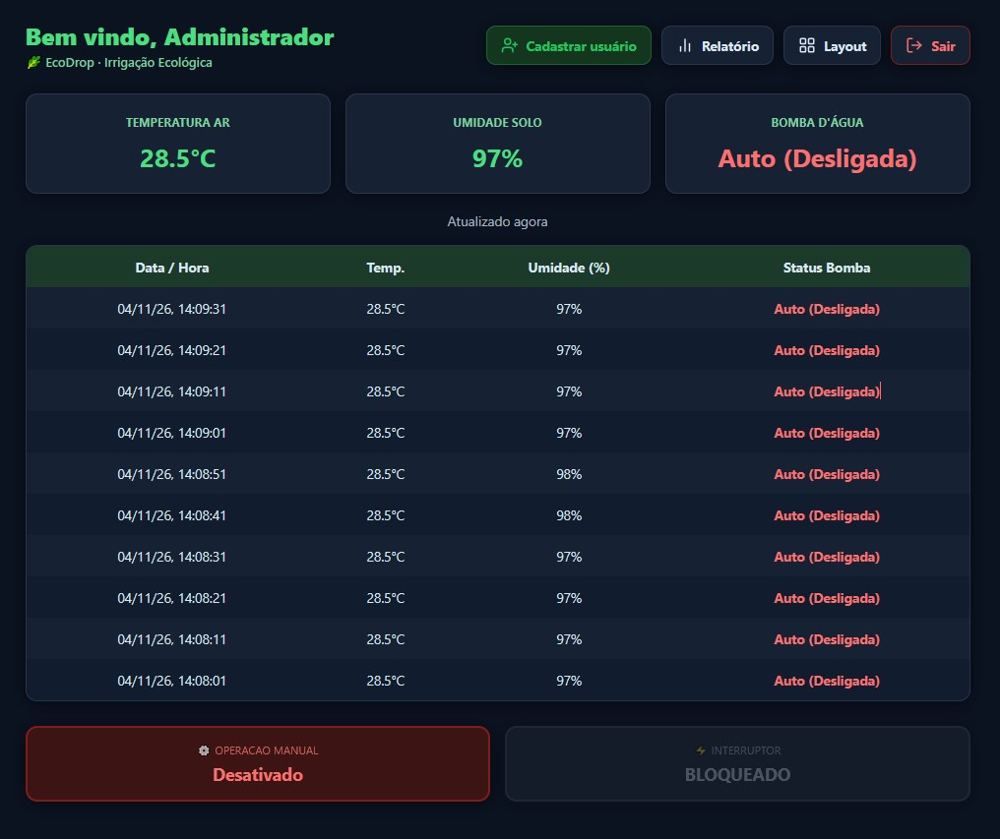
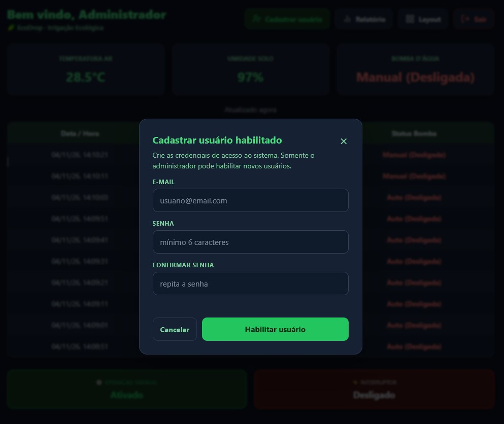
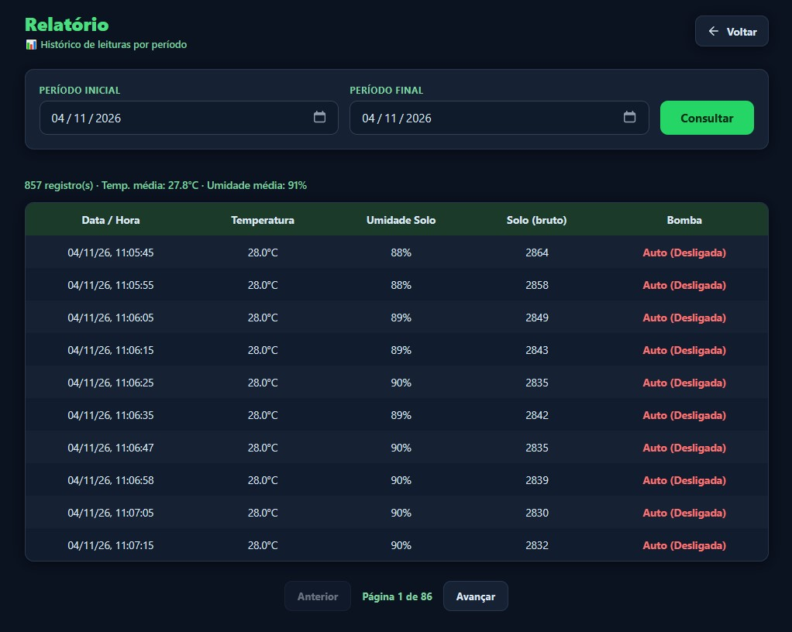
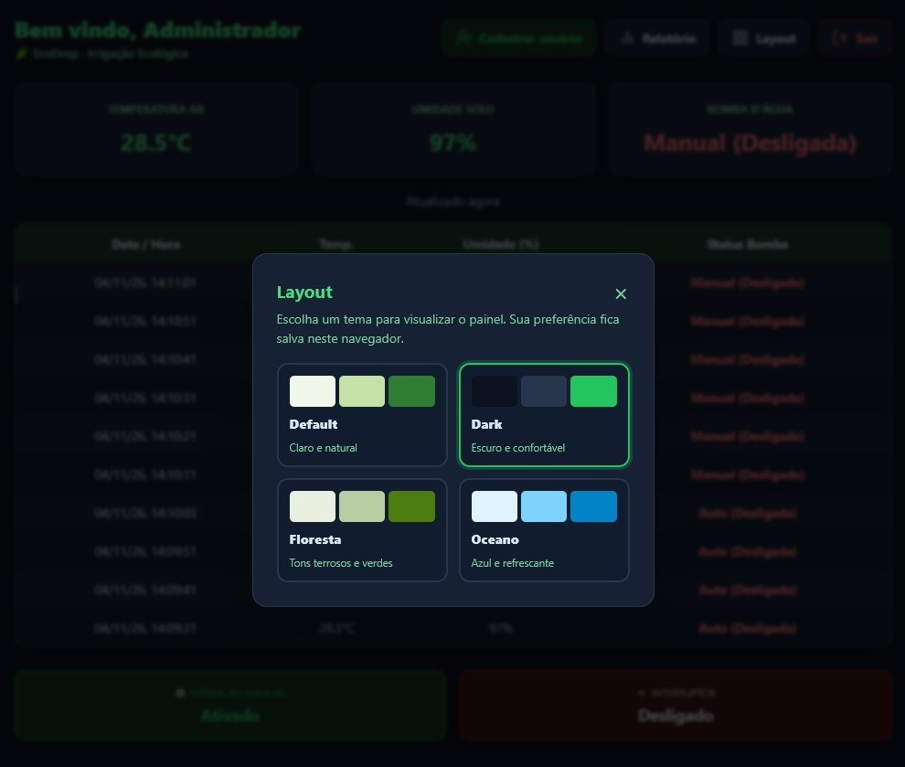
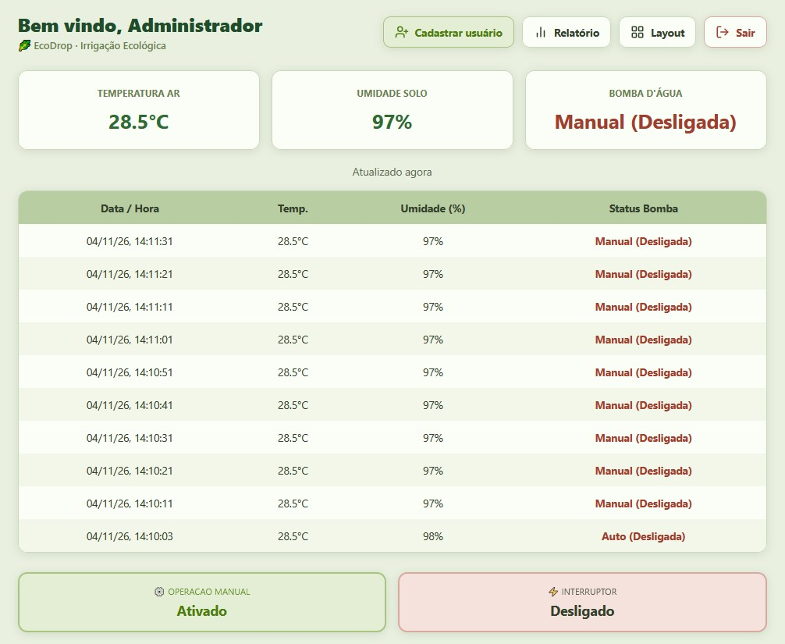
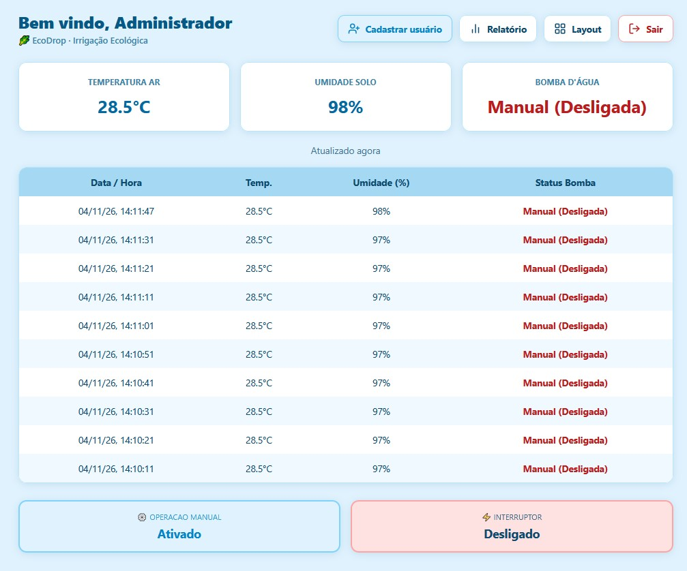
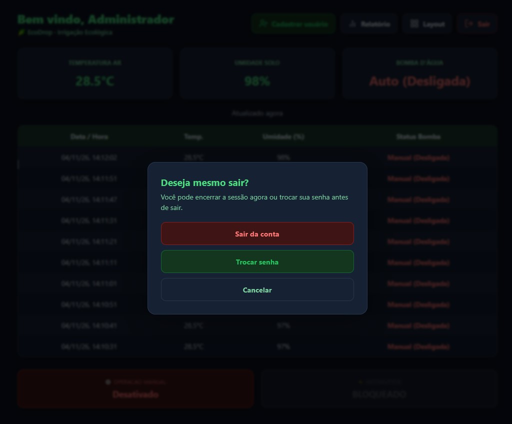
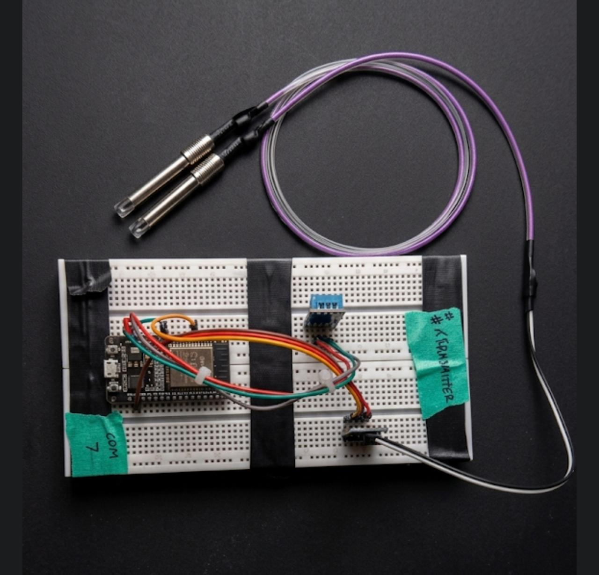
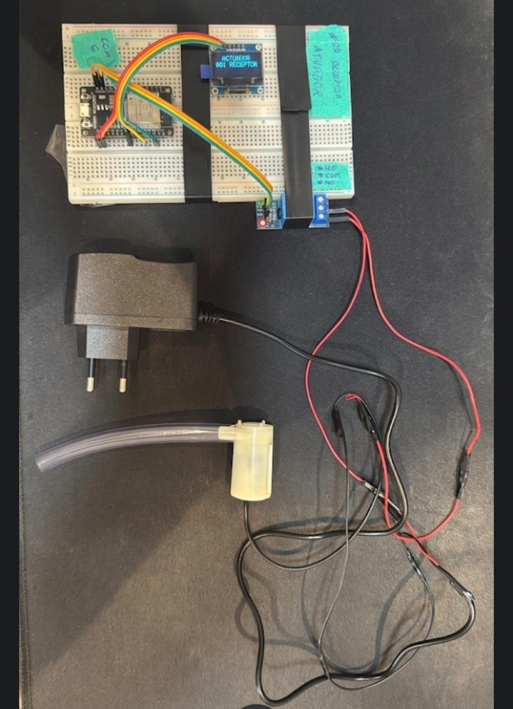

# 🌱 EcoDrop — Irrigação Inteligente com ESP32 e Firebase

Sistema de monitoramento e automação de irrigação que mede a umidade do solo e a temperatura do ar, aciona uma bomba d'água automaticamente e disponibiliza um dashboard web em tempo real com histórico, relatórios e controle manual.


---

## 📖 Sobre o Projeto

O EcoDrop nasceu para automatizar a irrigação de pequenas hortas e plantações. Dois módulos ESP32 se comunicam com a nuvem:

- **Transmissor:** lê os sensores de umidade do solo e temperatura/umidade do ar e publica as leituras no Firebase Realtime Database.
- **Receptor (atuador):** consulta o Firebase, decide o acionamento da bomba d'água (modo automático) ou obedece ao interruptor manual, e exibe as informações em um display OLED.
- **Dashboard web:** aplicação hospedada no Firebase Hosting com login, dados em tempo real, histórico, relatório por período e controle manual da bomba.

> Demonstração: <https://ecodrop-829e7.web.app>

---

## ✨ Funcionalidades

- 📊 Dashboard em tempo real (temperatura, umidade do solo e status da bomba).
- 🕘 Histórico contínuo das leituras gravado no Firebase (a cada 10 segundos).
- 📈 Relatório por período com filtros de data, médias e paginação.
- ⚙️ Modo automático: liga a bomba quando o solo está seco e desliga quando está úmido.
- 🎛️ Modo manual: interruptor web com prioridade sobre os sensores.
- 🔐 Autenticação de usuários com Firebase Auth e área administrativa.
- 🎨 Temas (Layout) para personalizar o dashboard.
- 📶 Robustez de rede: reconexão automática de Wi-Fi e timeouts HTTPS nos dois ESP32.
- ⏱️ Aviso de dados desatualizados no dashboard quando o dispositivo para de publicar.

---

## 🏗 Arquitetura

```
┌────────────────────┐        HTTPS         ┌──────────────────────┐
│  ESP32 Transmissor │ ───────────────────► │                      │
│  DHT11 + Solo      │                      │  Firebase Realtime   │
└────────────────────┘                      │  Database            │
                                            │                      │
┌────────────────────┐        HTTPS         │                      │
│  ESP32 Receptor    │ ◄──────────────────► │                      │
│  OLED + Relé/Bomba │                      └──────────┬───────────┘
└────────────────────┘                                 │
                                                       │ SDK Web
                                            ┌──────────▼───────────┐
                                            │  Dashboard (Hosting) │
                                            │  Auth + RTDB         │
                                            └──────────────────────┘
```

### 1. Transmissor (`src/transmissor_sensor`)
- Leitura do higrômetro (ADC) com média de 10 amostras.
- Leitura de temperatura pelo DHT11.
- Publicação do estado atual e gravação do histórico no Firebase a cada 10 segundos.
- Consulta o modo (`AUTOMATICO`/`MANUAL`) e o comando manual para registrar o status correto da bomba no histórico.

### 2. Receptor (`src/receptor_atuador`)
- Consulta o estado atual e a configuração do atuador a cada 5 segundos.
- Aciona o relé da bomba com prioridade para o modo manual.
- Exibe as leituras em um display OLED SSD1306.

### 3. Dashboard (`public/`)
- Aplicação SPA em HTML/CSS/JS usando o SDK compat do Firebase 10.
- Login/cadastro, troca de senha, temas de layout.
- Escuta em tempo real do estado, do modo e do histórico.
- Relatório com consulta `orderByChild("timestamp")` por intervalo de datas.

---

## 🛠 Tecnologias

- **Hardware:** ESP32, DHT11, higrômetro capacitivo/resistivo, display OLED SSD1306, módulo relé.
- **Firmware:** Arduino IDE (C++), bibliotecas `DHT`, `ArduinoJson`, `Adafruit SSD1306` e `Adafruit GFX`.
- **Backend/BaaS:** Firebase Realtime Database, Firebase Authentication e Firebase Hosting.
- **Frontend:** HTML5, CSS3 e JavaScript (SDK Firebase compat).

---

## 📁 Estrutura do Repositório

```
EcoDrop/
├── public/                      # Dashboard publicado no Firebase Hosting
│   ├── index.html
│   └── 404.html
├── src/
│   ├── transmissor_sensor/
│   │   ├── transmissor_sensor.ino
│   │   └── arduino_secrets.example.h
│   ├── receptor_atuador/
│   │   ├── receptor_atuador.ino
│   │   ├── arduino_secrets.example.h
│   │   └── IdentificaMAC/       # Utilitário para descobrir o MAC do ESP32
│   └── img/                     # Fotos e vídeos do projeto
├── Documentacao/                # Anotações e requisitos
├── firebase.json                # Configuração do Firebase Hosting
├── .firebaserc                  # Projeto Firebase padrão
├── desenvolvido.md              # Registro das implementações
└── README.md
```

---

## 📷 Demonstração

<p align="center">
  
  
  
  
  
  
  
</p>

<p align="center">
  
  
</p>

<p align="center">
  
  
</p>

---

## 🔌 Esquema de Ligação (Pinagem)

### 🛰️ 1. Nó Transmissor

| Componente | Pino Componente | Pino ESP32 | Observação |
| :--- | :--- | :--- | :--- |
| **DHT11** | VCC | VIN (5V) | Alimentação do sensor |
| **DHT11** | DAT / OUT | D26 | Sinal de dados |
| **DHT11** | GND | GND | Terra comum |
| **Higrômetro** | VCC | VIN (5V) | Alimentação do sensor |
| **Higrômetro** | GND | GND | Terra comum |
| **Higrômetro** | A0 | D34 | Leitura analógica (ADC) |

### 🎛️ 2. Nó Receptor

| Componente | Pino Componente | Pino ESP32 | Observação |
| :--- | :--- | :--- | :--- |
| **Display OLED** | GND | GND | Terra do display |
| **Display OLED** | VDD / VCC | 3V3 | Alimentação lógica |
| **Display OLED** | SCK / SCL | D22 | Barramento I2C - clock |
| **Display OLED** | SDA | D21 | Barramento I2C - dados |
| **Módulo Relé** | IN | D5 | Sinal de controle da bomba |
| **Módulo Relé** | GND | GND | Terra do relé |
| **Módulo Relé** | VCC | VIN (5V) | Alimentação da bobina |

### ⚡ 3. Circuito de Potência (Bomba d'água & Fonte 12V)

O relé funciona como interruptor do polo positivo (+) da alimentação da bomba:

- **Fonte 12V (Positivo)** ➡️ pino **COM** (comum) do relé
- **Bomba d'água (Positivo)** ➡️ pino **NO** (normalmente aberto) do relé
- **Fonte 12V (Negativo)** ➡️ **Bomba d'água (Negativo)**

> ⚠️ Use fonte adequada para a bomba e nunca alimente a bomba diretamente pelo ESP32.

---

## 🚀 Como Executar

### Pré-requisitos

- [Arduino IDE](https://www.arduino.cc/en/software) com suporte ao ESP32.
- Conta no [Firebase](https://console.firebase.google.com/).
- [Node.js](https://nodejs.org/) e Firebase CLI (`npm install -g firebase-tools`) para publicar o dashboard.

### 1. Clonar o repositório

```bash
git clone https://github.com/Cirqueira/EcoDrop.git
cd EcoDrop
```

### 2. Configurar credenciais dos ESP32

O arquivo `arduino_secrets.h` não é versionado. Em **cada** pasta de firmware, copie o exemplo e preencha:

```bash
# Windows (PowerShell)
Copy-Item src/transmissor_sensor/arduino_secrets.example.h src/transmissor_sensor/arduino_secrets.h
Copy-Item src/receptor_atuador/arduino_secrets.example.h src/receptor_atuador/arduino_secrets.h
```

Edite `arduino_secrets.h`:

```cpp
const char* WIFI_SSID = "SUA_REDE";
const char* WIFI_PASSWORD = "SUA_SENHA";
const char* API_KEY = "SUA_API_KEY";
const char* DATABASE_URL = "https://SEU_PROJETO-default-rtdb.firebaseio.com";
```

### 3. Instalar bibliotecas na Arduino IDE

- `DHT sensor library` (Adafruit) + `Adafruit Unified Sensor`
- `ArduinoJson`
- `Adafruit SSD1306` + `Adafruit GFX Library`

### 4. Configurar o Firebase

1. Crie um projeto no Firebase Console.
2. Ative o **Realtime Database** e o **Authentication** (método e-mail/senha).
3. Cadastre o usuário administrador em **Authentication > Users**.
4. Crie o dashboard web em **Configurações do projeto > Seus apps** e copie o `firebaseConfig`.
5. Atualize `firebaseConfig` no `public/index.html` e a constante `ADMIN_EMAIL`.
6. Atualize `.firebaserc` com o ID do seu projeto.

### 5. Gravar os ESP32

- Abra `src/transmissor_sensor/transmissor_sensor.ino` e grave no ESP32 transmissor.
- Abra `src/receptor_atuador/receptor_atuador.ino` e grave no ESP32 receptor.

### 6. Publicar o dashboard

```bash
firebase login
firebase use SEU_PROJETO
firebase deploy --only hosting
```

---

## 🗄️ Modelo de Dados (Realtime Database)

| Caminho | Descrição |
| :--- | :--- |
| `dispositivos/ESP32_Solo_01/estado_atual` | Última leitura (temperatura, umidade, solo bruto, bomba e timestamp) |
| `dispositivos/ESP32_Solo_01/historico` | Lista de leituras históricas (push) com `timestamp` do servidor |
| `atuadores/bomba_dagua/modo` | `AUTOMATICO` ou `MANUAL` |
| `atuadores/bomba_dagua/comando_manual` | Estado do interruptor manual (`true`/`false`) |

Para o relatório funcionar com bom desempenho, crie o índice:

```json
{
  "dispositivos": {
    "ESP32_Solo_01": {
      "historico": {
        ".indexOn": ["timestamp"]
      }
    }
  }
}
```

---

## 🔐 Segurança

- `arduino_secrets.h` está no `.gitignore` — **nunca** faça commit de senhas de Wi-Fi ou chaves privadas.
- O `apiKey` do Firebase web é público por natureza; proteja os dados com **regras do Realtime Database** e com o **Firebase Authentication**.
- Recomenda-se restringir a escrita do nó `atuadores` e validar os dados no servidor.
- Troque a senha do usuário administrador periodicamente.

---

## 🩺 Solução de Problemas

| Sintoma | Possível causa | Ação |
| :--- | :--- | :--- |
| Dashboard mostra "Sem atualização há X min" | ESP32 parou de publicar (Wi-Fi caiu, travou ou perdeu energia) | Verifique a alimentação, o Wi-Fi e o Serial Monitor (115200) |
| Bomba não liga no modo manual | Receptor não está lendo `atuadores/bomba_dagua` | Confira as regras do banco e o modo `MANUAL` |
| Login não funciona | Usuário não cadastrado no Firebase Auth | Cadastre em Authentication > Users |
| Relatório vazio | Histórico fora do intervalo ou índice ausente | Ajuste as datas e crie o `.indexOn` |

---

## 👨‍💻 Autor

Desenvolvido por **Leonard Cirqueira** — 2026.

- GitHub: [@Cirqueira](https://github.com/Cirqueira)
- Repositório: <https://github.com/Cirqueira/EcoDrop>
